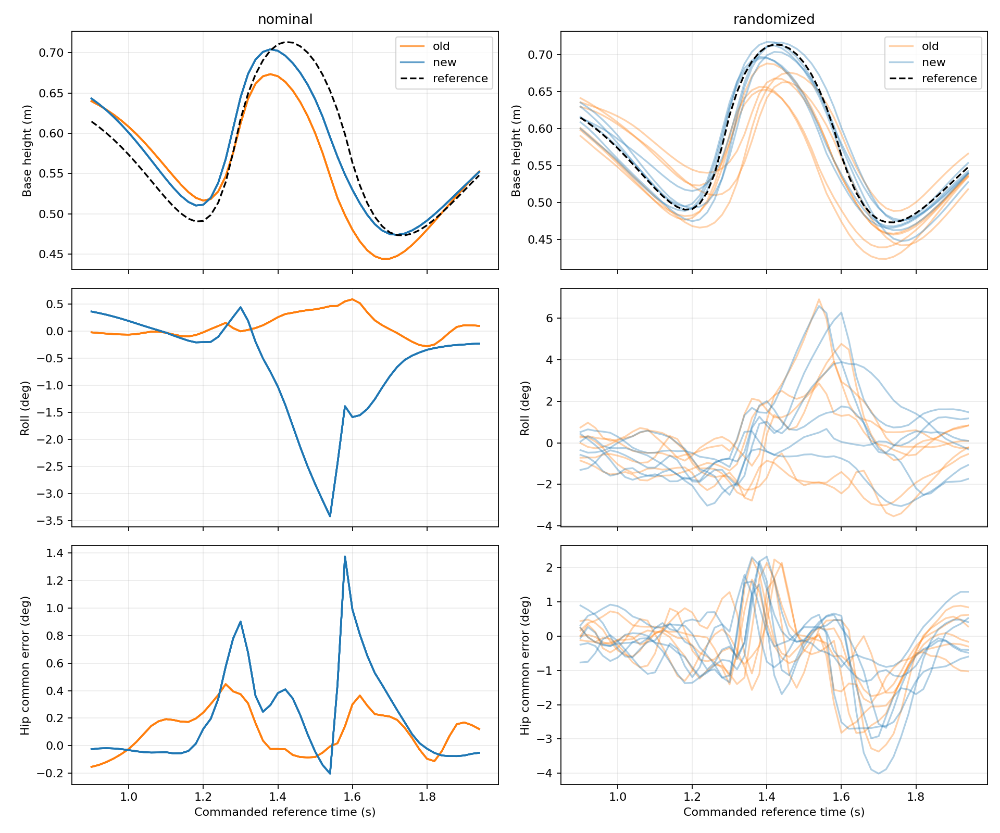

# 评估批次 wheel-to-leg-fixed-start-20261107-001

任务：`RobotLab-Isaac-BeyondMimic-Flat-LW-wheel-v0`；训练：`2026-11-06_11-39-51`。

本报告汇总已校验的用例；completed 表示证据发布完成，策略表现须结合指标和视频判断。

| 用例 / 尝试 | 状态 | 场景、步数 / 环境 / seed | 遥测 | 结果与视频 |
| --- | --- | --- | --- | --- |
| fixed-start-nominal-a01 | completed | fixed-start-nominal，1000 / 1 / 42 | complete | [结果](<raw/fixed-start-nominal-a01/result.json>) / [日志](<raw/fixed-start-nominal-a01/console.log>) |
| fixed-start-randomized-a01 | completed | fixed-start-randomized，1000 / 1 / 42 | complete | [结果](<raw/fixed-start-randomized-a01/result.json>) / [日志](<raw/fixed-start-randomized-a01/console.log>) |

## 策略与场景

- checkpoint SHA-256：`72a75d2cbfe756e452f135ed01599f72601b8093559c0285b66438ecc2a271c1`；runner：`OnPolicyRunner`。
- [场景来源 scenario-2163aeae43841a2706d1735a66d02e94370a942809a0647e3199070ee6337ce5.json](<../../provenance/scenario-2163aeae43841a2706d1735a66d02e94370a942809a0647e3199070ee6337ce5.json>)
- [场景来源 scenario-c293f46c61eedb59bb79315db64ee4c3f61d574bce901983c33b6bb7deb2f397.json](<../../provenance/scenario-c293f46c61eedb59bb79315db64ee4c3f61d574bce901983c33b6bb7deb2f397.json>)
- [训练上下文 context-b4eb3634f7283f071a1a6855d565aa22d4556ba63ebd14c331af76e74a578bbf.json](<../../provenance/context-b4eb3634f7283f071a1a6855d565aa22d4556ba63ebd14c331af76e74a578bbf.json>)
- [训练有效配置 config-f7ccd64b04371fd4fab2c4159b0cbeec87ece7115f1fcf7874e63a9a9c3b8cb2.json](<../../provenance/config-f7ccd64b04371fd4fab2c4159b0cbeec87ece7115f1fcf7874e63a9a9c3b8cb2.json>)

- `fixed-start-nominal-a01` 指标：`{"max_joint_velocity_utilization": "unavailable", "max_tilt": "unavailable", "termination_rate": "unavailable", "tracking_xy_rmse": "unavailable", "tracking_yaw_rmse": "unavailable"}`
- `fixed-start-nominal-a01` 命令调度：`[]`；训练配置覆盖：`{"evaluation.motion_ground_contacts": true, "evaluation.motion_mode": "nominal_start", "evaluation.motion_physics_window": [0, 169], "evaluation.motion_sha256": "8ffd6f093bdeacf2f8aec5fa0ccf0c660a51d0fdc6e073ecc7bc0ffe6fa5da03", "rewards.hip_pos_zero_l2.weight": -2.0}`。
- `fixed-start-randomized-a01` 指标：`{"max_joint_velocity_utilization": "unavailable", "max_tilt": "unavailable", "termination_rate": "unavailable", "tracking_xy_rmse": "unavailable", "tracking_yaw_rmse": "unavailable"}`
- `fixed-start-randomized-a01` 命令调度：`[]`；训练配置覆盖：`{"evaluation.motion_ground_contacts": true, "evaluation.motion_mode": "randomized_start", "evaluation.motion_physics_window": [0, 169], "evaluation.motion_sha256": "8ffd6f093bdeacf2f8aec5fa0ccf0c660a51d0fdc6e073ecc7bc0ffe6fa5da03", "rewards.hip_pos_zero_l2.weight": -2.0}`。

## 观察与限制

- 当前模型为 2026-11-06_11-39-51/model_49999.pt，SHA-256 72a75d2cbfe756e452f135ed01599f72601b8093559c0285b66438ecc2a271c1。训练与评估源码均为 88cc27d03df1a61829a85365a35092a1359a955c。用户确认 bash scripts/start_beyondmimic.sh --type wheel，无额外 CLI/Hydra 参数。
- 对照模型为 2026-11-05_16-40-14/model_49999.pt，复用已封存评估。完整保存配置比较：agent 无差异；env 除 log_dir 外仅新增 motion_flight_height（weight=2.0、std=0.10m、参考窗口1.10–1.90s、首尾ramp=0.05s）。镜像增强及对称损失仍开启，mirror_loss_coeff=0.1；基座竖直偏差终止阈值仍为0.25m，未启用竖直速度奖励。
- 两组 Native 评估各1环境、1000控制步、seed42，从参考frame0开始；标称条件与保留训练随机化条件顺序执行，无视频。每组5个覆盖frame0..169的完整成功周期、0失败、1个未结束尾周期。20ms控制遥测各1000条、5ms物理遥测各4000条，必要信号完整。未重跑历史策略、训练或导出。
- 结论：本轮起跳高度、竖直速度及落地高度跟踪明显改善，标称足关节力矩触限消失；但标称腾空末段横滚、双髋同向误差和足接触力峰值有所增加，随机化足关节仍短时超速，不能仅据高度改善判断策略全面更优。
- 统计口径：以下主表覆盖每场1000步，含第6个截尾周期中已覆盖的阶段；成功数仅统计5个完整周期。height-landing-analysis.json 另列完整周期统计。高度比较采用基座link-origin世界Z、同一命令参考帧；记录状态为该控制步结束值，实际物理时间比命令参考时间晚20ms。起跳最高点/横滚窗口为参考1.1–1.7s，落地高度RMSE为1.45–1.9s（含端点）；竖直速度为基座COM世界Z速度。
- 新旧对比：

| 指标 | 旧版标称 | 本版标称 | 旧版随机化 | 本版随机化 |
|---|---:|---:|---:|---:|
| 起跳最高点均值 m | 0.6735 | 0.7044 | 0.6670 | 0.7067 |
| 向上速度峰值 m/s | 1.7096 | 1.8366 | 1.8297 | 2.1551 |
| 最大高度绝对偏差 cm | 10.9026 | 5.7760 | 12.2770 | 6.2026 |
| 落地高度RMSE cm | 6.0164 | 2.8713 | 4.4170 | 2.0928 |
| 落地最低基座高度 m | 0.4439 | 0.4738 | 0.4239 | 0.4479 |
| 起跳/腾空横滚峰值 deg | 0.5909 | 3.4235 | 6.9116 | 6.5881 |
| 推蹬双髋同向误差峰值 deg | 0.4471 | 0.9013 | 1.4113 | 1.7852 |
| 推蹬质心侧偏峰值 cm | 0.1809 | 0.3142 | 4.7259 | 5.0170 |
| 单足法向接触力范数峰值 N | 1143.9952 | 1214.9579 | 1348.9515 | 1508.0868 |
| 单轮法向接触力范数峰值 N | 877.5030 | 427.8957 | 964.5023 | 958.6757 |
- 高度与速度：参考起跳最高点0.71351m、向上COM速度峰值1.96683m/s。标称最高点0.67352→0.70445m，距参考最高点由4.00cm缩至0.91cm；标称速度峰值1.70960→1.83658m/s。随机化各周期最高点0.65235–0.68782→0.69500–0.71690m，速度峰值1.41205–1.82972→1.75680–2.15513m/s；峰值并非同一时刻的误差。
- 时序与落地：标称最大高度偏差10.90→5.78cm，本版最差点参考1.54s（物理1.56s），实际0.59520m、参考0.65296m。落地最低点0.44391→0.47381m；本版最低点参考1.72s的参考值为0.47353m，差+0.028cm。仍存在腾空下降阶段的高度/时序差异，不能把最低点贴近参考解释为全段准确。随机化最大偏差12.28→6.20cm；其最低点范围本版为0.44786–0.47644m，最低值来自截尾第6周期，仅前5个完整周期范围为0.46266–0.47644m。
- 接触时序：以连续15ms低于/高于10N判定监测接触状态，5ms采样。标称首次连续足接触物理时间1.575→1.570s，监测离地间隔均为245ms；随机化离地间隔205–240→245–270ms。推蹬最后双轮卸载差（左减右）标称+5→−5ms，随机化仍为−10至+10ms。这里仅覆盖四足轮及四个大腿/小腿监测接触，不能证明任意未监测部位均无接触。
- 侧倾与对称性：标称横滚峰值0.591→3.423°，本版峰值在参考1.54s/物理1.56s，早于首次连续足接触1.57s，不能简单归因为触地冲击。随机化横滚峰6.912→6.588°，落地俯仰峰11.335→12.872°。推蹬窗口为物理1.10–1.38s，双髋同向误差定义为(qL+qR−qL_ref−qR_ref)/2；全身质心用实际质量/局部COM重建，侧偏相对两轮中心中点沿yaw侧向轴投影，不等同于稳定裕度。
- 网络镜像诊断：名义观测重建与本模型记录动作最大误差5.72e−6；起跳/落地位置动作镜像RMS为0.0956°/0.1369°。在同一旧策略名义观测上，旧模型0.1264°/0.1408°，本模型0.1158°/0.1468°；无明显网络偏侧恶化证据，闭环侧倾增加需结合动力学与接触分析。随机化诊断仅为去噪、名义默认关节位置下的状态探测，不宣称精确回放。
- 负载取舍：标称足部峰值1144→1215N（约+6.2%），轮部878→428N；随机化足部1349→1508N（约+11.8%），轮部965→959N。这些是5ms步平均PhysX法向力，不含摩擦，不能作为实物瞬时冲击峰值。驱动力矩与被动结构冲击分别解释。
- 本版各关节5ms绝对峰值，速度rad/s、applied驱动力矩Nm：

| 关节 | 标称速度 | 随机化速度 | 配置速度限值 | 标称力矩 | 随机化力矩 | 力矩限值 |
|---|---:|---:|---:|---:|---:|---:|
| left_hip_joint | 1.638 | 2.161 | 20 | 43.329 | 55.467 | 120 |
| right_hip_joint | 2.922 | 2.943 | 20 | 43.704 | 42.908 | 120 |
| left_thigh_joint | 11.941 | 14.366 | 20 | 32.441 | 42.231 | 120 |
| right_thigh_joint | 12.437 | 14.279 | 20 | 23.657 | 49.494 | 120 |
| left_shank_joint | 15.755 | 17.279 | 20 | 79.073 | 99.598 | 120 |
| right_shank_joint | 16.172 | 17.495 | 20 | 78.501 | 88.085 | 120 |
| left_foot_joint | 7.324 | 10.362 | 10 | 15.591 | 25.159 | 27 |
| right_foot_joint | 5.388 | 10.260 | 10 | 14.565 | 21.957 | 27 |
| left_wheel_joint | 10.953 | 16.279 | 33 | 2.001 | 6.825 | 40 |
| right_wheel_joint | 10.117 | 13.517 | 33 | 1.745 | 5.614 | 40 |
- 两场本版均无applied力矩触限；标称左足峰值27.0→15.59Nm，右足25.93→14.57Nm，先前左足短时触限消失。随机化左/右足速度峰10.362/10.260rad/s，仍超过配置10rad/s，累计15/5ms；旧版为10.473/10.911rad/s、累计10/15ms。新随机化最大胫关节速度17.495rad/s、最大腿部驱动力矩99.60Nm，分别低于20rad/s与120Nm配置限值。未据此作硬件验收。
- 训练记录：checkpoint内部iter及TensorBoard最大step均为49999；所选27项标量最后5000条均为有限值。最后1000条日志motion_finished均值为0.996163，symmetry loss均值0.00014616。训练采用自适应参考相位初始化，这些日志均值不是从frame0完成整段动作的独立成功率；奖励新增后不以总reward跨版本排名。
- 已记录的初始刚体质量、局部COM、材料及PhysX joint stiffness/damping在各对应场景中逐元素一致；软件PD增益与随机延迟的实际抽样没有独立捕获，不能据此宣称所有运行条件均已测量相同。单环境、单seed、少量重复周期不证明收敛、普遍稳定或最优奖励权重。
- 现有checkpoint、exports与历史证据共37个文件及18个相关源码文件SHA-256保持不变，stash保持不变，tracked diff为空；GPU评估进程已退出。此处只新增本轮评估证据，没有训练、修改配置、导出或Git提交。
- 
- 未提供用户批准的收敛判据时，不作收敛判断；缺失遥测不能按零值解释。
- 视频需经机器人持续在画面内的人工检查后才可作为动作证据。

## 相关证据

- [analysis.json](<derived/analysis.json>)
- [height-landing-analysis.json](<derived/height-landing-analysis.json>)
- [joint-loads.csv](<derived/joint-loads.csv>)
- [diagnostic.json](<derived/offline-policy-symmetry/diagnostic.json>)
- [phase-errors.png](<derived/offline-policy-symmetry/phase-errors.png>)
- [samples.csv](<derived/offline-policy-symmetry/samples.csv>)
- [phase-comparison.png](<derived/phase-comparison.png>)
- [takeoff-coupling.csv](<derived/takeoff-coupling.csv>)
- [effective-config-diff-20261107-001.json](<../../evidence/training/effective-config-diff-20261107-001.json>)
- [evaluation-request-20261107-001.json](<../../evidence/training/evaluation-request-20261107-001.json>)
- [protection-after-20261107-001.json](<../../evidence/training/protection-after-20261107-001.json>)
- [tensorboard-windows-20261107-001.json](<../../evidence/training/tensorboard-windows-20261107-001.json>)
- [training-origin-20261107-001.json](<../../evidence/training/training-origin-20261107-001.json>)

## 建议与待授权事项

- 保留本版作为高度改善基线，优先分析推蹬至腾空末段的横滚增长，以及随机化足关节超速和足接触峰值；暂不继续加大高度权重或收紧终止阈值。
- 若要检验高度权重与侧倾/冲击的取舍，另行提出只将高度权重2.0改为1.0的受控对照，并在相同评估条件下比较；现有单对训练不能证明2.0过严或1.0一定更好。
- 所有进一步训练、配置改动、扩展seed或视频回放均属于后续工作，本批不自动执行。
