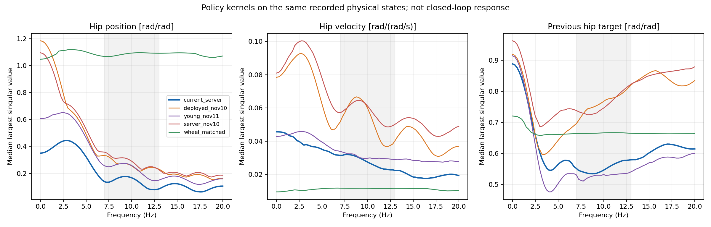
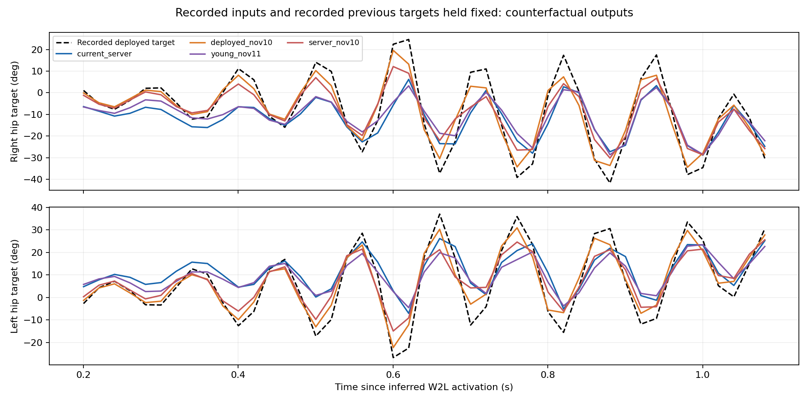

# 实机状态上的双髋策略敏感度对比

本次策略：`2026-11-11_19-54-20/model_49999.pt`，SHA-256 `078d1aac4c78970d392517395761a2ddf195265f5d29086fff7bd4f7b48d2906`。

**结论：相对发生实机抖动的11月10日策略，本次策略的局部位置、速度、上一目标角敏感度均降低；但与youngHit 11月11日对照相比，部分历史动作依赖及固定实机历史下的目标振荡仍更大。尚不能认定实机闭环抖动已消除。**

实机数据来自 `20261111-163120-wheel-to-leg-takeoff-oscillation`，实际部署模型为用户确认的youngHit 11月10日模型（ONNX `0b2032d7…0249912f`）。本次策略没有对应实机试验，以下结果都是在旧实机轨迹上进行离线计算。

## 数据与比较口径

- 推断转换起点row1055；使用row1065–1109共45个成熟历史窗口，名义相位0.20–1.10s，实际bag时间21.305590–22.185845s。保留10帧、20ms历史。
- 四版W2L使用完全相同590维重构观测；Wheel使用相同物理状态和上一物理目标重编码的390维输入，任务命令与观测布局不同，因此只作背景参照。
- 输入通道为双髋位置rad、速度rad/s、上一目标角rad；输出为双髋目标角rad。输入和输出的scale均换算回物理单位，不能把原始网络action梯度直接当成物理敏感度。
- 每个状态、每个通道、每个历史槽分别做双侧中心差分；扰动步长依次为0.001rad、0.01rad/s、0.001rad。表中数值为2×2双髋Jacobian的最大奇异值在45个状态上的中位数；不是每个单关节的固定增益，也不是机械传递函数。
- 最新帧表示lag0；10Hz表示把10个历史槽的局部响应按相位合成。上一目标角分支的额外一拍相位保存在数组中，不改变该分支的奇异值幅度。

## 最新帧双髋敏感度

| 策略 | 位置 rad/rad | 速度 rad/(rad/s) | 上一目标角 rad/rad |
| --- | ---: | ---: | ---: |
| 本次 server 11-11 19:54:20 | 0.14157 | 0.02473 | 0.57430 |
| 实机旧版 youngHit 11-10 14:03:57 | 0.25024 | 0.04977 | 0.74821 |
| 对照 youngHit 11-11 19:51:59 | 0.22848 | 0.02995 | 0.53579 |
| 本机旧版 server 11-10 13:58:00 | 0.26220 | 0.05781 | 0.79308 |
| Wheel，同一物理状态重编码 | 1.08829 | 0.01115 | 0.66482 |

相对实机旧版，本次三项分别降低 **43.42%、50.31%、23.24%**。相对本机11月10日旧版，分别降低 **46.01%、57.23%、27.59%**。

相对youngHit 11月11日对照，位置和速度分别降低 **38.04%、17.43%**，但上一目标角敏感度提高 **7.19%**。因此不能用“所有通道都更低”概括本次策略。

本次三项p95分别为 **0.16147、0.03033、0.66050**，完整各策略p95见 [comparison.csv](comparison.csv)。

## 10Hz附近响应

| 策略 | 位置 rad/rad | 速度 rad/(rad/s) | 上一目标角 rad/rad |
| --- | ---: | ---: | ---: |
| 本次 server 11-11 19:54:20 | 0.16752 | 0.02743 | 0.54611 |
| 实机旧版 youngHit 11-10 14:03:57 | 0.25602 | 0.05970 | 0.76765 |
| 对照 youngHit 11-11 19:51:59 | 0.25857 | 0.02976 | 0.53193 |
| 本机旧版 server 11-10 13:58:00 | 0.29055 | 0.06107 | 0.74634 |
| Wheel，同一物理状态重编码 | 1.09257 | 0.01172 | 0.66620 |

在实机约9–10Hz振荡附近，本次10Hz速度敏感度比实机旧版降低 **54.06%**，上一目标角响应降低 **28.86%**；但速度敏感度仍是Wheel同状态参照的 **2.34倍**。Wheel参照不构成已验证的安全阈值。

同号/反号指关节编码器坐标，不强行对应机器人解剖方向。本次速度和上一目标角的最大响应主要接近双髋反号方向；反号方向10Hz中位数分别为 **0.02742、0.54603**，同号方向为 **0.01632、0.41558**。反号分支仍值得关注。

## 直观的有限扰动检查

只改变最新槽中的单个输入、其余观测和历史保持原记录，45个状态平均：

| 单侧输入扰动 | 同侧目标角平均变化 | 对侧目标角平均变化 |
| --- | --- | --- |
| 髋位置 +1° | 约 −0.111° | 约 −0.029～−0.032° |
| 髋速度 +0.1rad/s | 约 −0.122～−0.124° | 约 +0.013～+0.014° |
| 上一髋目标 +1° | 约 +0.535～+0.537° | 约 −0.028～−0.034° |

这说明本次策略对单帧位置/速度扰动的反应减小，但上一动作仍显著影响下一目标。它不是实际驱动力矩响应；把单个分支增益小于1当成整体稳定性证明是不成立的。

## 固定实机历史后的输出振荡

这里始终输入记录中的状态与上一目标，不把新策略的预测递归送回历史。统计45点目标角，去线性趋势、Hann窗、rFFT后求7–13Hz未归一化功率；该功率只能在同长度、同单位和同窗处理下比较。

| 策略 | 右髋目标峰峰值 ° | 左髋目标峰峰值 ° | 右/左最大相邻变化 ° |
| --- | ---: | ---: | --- |
| 本次 server 11-11 19:54:20 | 35.08 | 33.20 | 20.86 / 21.17 |
| 实机旧版 youngHit 11-10 14:03:57 | 54.11 | 53.17 | 30.33 / 31.68 |
| 对照 youngHit 11-11 19:51:59 | 31.86 | 27.96 | 20.55 / 15.82 |
| 本机旧版 server 11-10 13:58:00 | 42.32 | 40.51 | 21.84 / 25.43 |

相对实机旧版，本次右/左髋7–13Hz目标功率降低 **57.21%/57.51%**。相对本机11月10日策略降低 **15.46%/23.28%**。

**相对youngHit 11月11日对照，本次右/左髋7–13Hz功率反而高46.53%/69.82%。** 单个输入通道更不敏感，不能保证整条记录上的输出振荡更小；实际输出由全部输入、历史和非线性工作点共同决定。这里不能把差异直接归因为某一个奖励或上一动作分支。

## 与已完成Native测试结合

本机Native测试中，两场均5个完整动作成功，但随机轮距平均47.05cm、最窄40.64cm，右/左髋最大偏角11.24°/11.06°。敏感度较低与几何约束表现更好是不同问题：本次离线分析不能推翻已观测的轮距和偏角退步。也不能证明关闭leg_symmetry导致敏感度降低。

本次与youngHit 11月11日策略至少同时存在leg_symmetry 0.5→0、wheel_contact_continuous 0→0.5的差异；与实机旧版还同时改变脚间距惩罚和髋归零惩罚。四版W2L的policy观测、动作和网络核心配置语义未发现差异，核对结果见 [policy-contract-comparison.json](policy-contract-comparison.json)。

## 校验与局限

- 原始实机bag、解码数据及部署配置/模型的引用哈希已核验；外地主机路径只在读取时映射到本地，原始证据没有重写。
- 本次已有ONNX `2bd05d3ab8131e96e599935e3f214b3602f32fa6d0e00456138ea7bc67b6da56`的8个actor权重张量与checkpoint完全一致；45状态native/ONNX最大原始输出差为2.8610e-6。未执行新导出。
- 独立重构的590维输入与历史缓存最大差6.20e-6，来自参考动作插值数值差；双髋位置、速度、上一动作最新槽均与原始实机行完全一致。
- 实机旧模型重构目标RMSE仍为右5.09°、左4.59°，相关性约0.972/0.975。缺少实际网络输入、推理时刻和完整内部状态，因此不能声称精确部署重放。一行状态偏移是重构假设，不是测得20ms硬件延迟。
- 新策略中心差分与float64自动微分的通道相对L2误差分别0.154%、0.104%、0.044%；半/双步长复核也通过，所有结果有限。三份历史Jacobian重新计算后与缓存最大差均为0。
- youngHit 11月11日原分析ONNX与正式归档ONNX哈希不同；保留原始失败预检及两个真实哈希，使用正式归档模型8ba46589…f7e28，并复核45状态输出及全部有限差分Jacobian与旧分析完全一致。没有通过修改旧哈希跳过校验。
- 57个直接保护输入、源码、HEAD与stash检查未变；无新训练、仿真、实机运行、导出、安装、删除或Git提交。
- 单段0.9s记录与局部线性化不能给出整机闭环稳定裕度、机械共振或真实电机增益。较低敏感度和较低离线目标频带功率只是改善线索。

## 判断与后续

本次策略相对实际抖动旧版具有明确的局部敏感度下降，但尚无新策略的实机闭环证据；它也没有在所有离线指标上优于youngHit 11月11日对照。建议保留两版候选，先将同一套多seed Native结果与实机状态敏感度一起比较，重点兼顾轮距、落地姿态和上一动作分支，再决定下一次受监督实物测试。

`direct_parameter_change_supported=false`。本报告不自动修改参数。仅可进入受监督实物测试；未经实物验证，不代表 hardware-ready。

完整数值见 [analysis.json](analysis.json)、[comparison.csv](comparison.csv)；完整输入、Jacobian和频率响应见 [sensitivity-arrays.npz](sensitivity-arrays.npz)。
