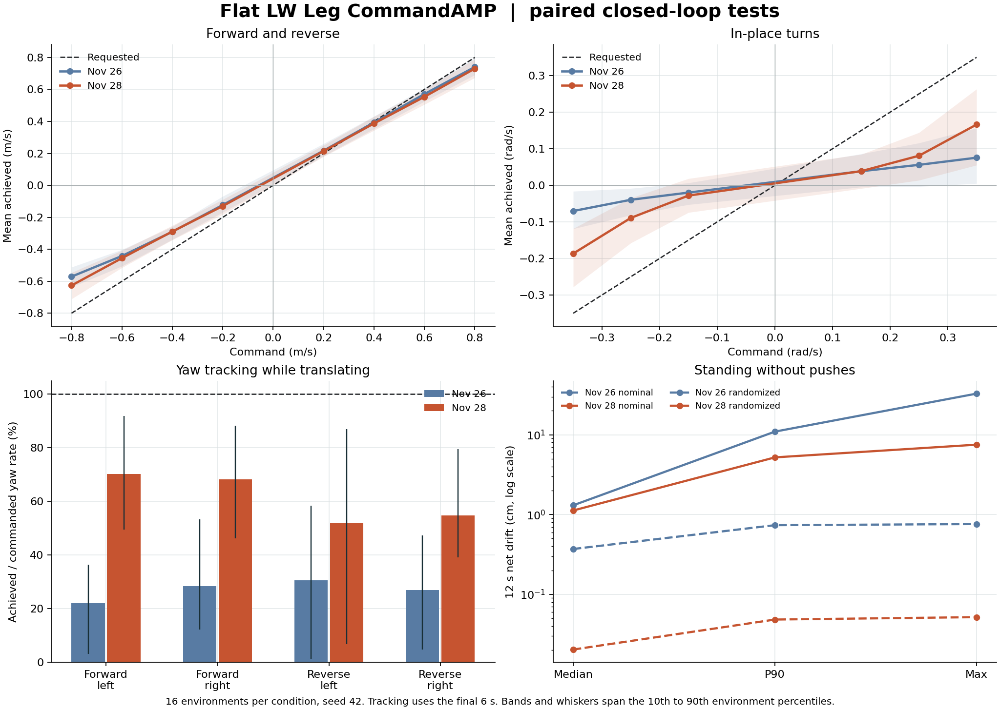
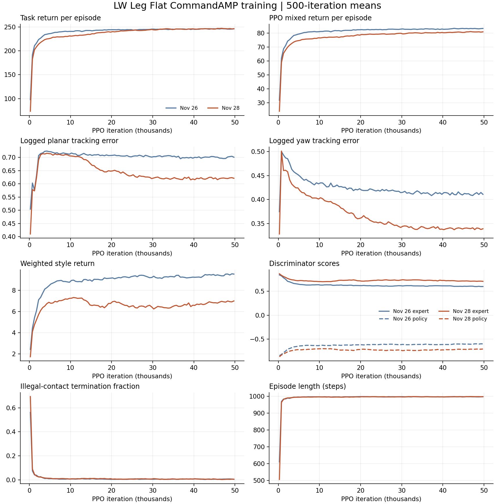

# LW Leg Flat CommandAMP 两轮策略对比

11 月 28 日训练的策略站得更稳，大角速度转向和高速倒退也更接近指令。原地转向仍有明显欠速，前进中高速档略慢。两轮都取默认脚本训练的 `model_50000.pt`。

11 月 28 日检查点在 Isaac Lab 中实测 22 个场景，和 11 月 26 日已校验的同场景记录逐项对照。每场景 16 个环境，种子 42。两轮各 352 个场景环境组合均无提前终止或超时。恒速测试在静站 2 秒后给定指令 8 秒，统计最后 6 秒。下文表格均按上一轮 → 本轮排列。[本轮评估批次](../../../evaluations/commandamp-50000-paired-flat-20261128-001/report.md) · [证据与校验值](comparison-evidence.json)

## 静站与启动阈值

关闭外部推扰，给零指令 14 秒，统计第 2 至 14 秒的机身原点水平净位移。标称使用平面、固定动力学和零执行器延时。随机化组保留训练微起伏地形、质量、质心、摩擦、驱动延时和重置随机化。两组均关闭策略观测噪声。

| 工况 | 净位移中位数 | 第 90 百分位 | 最差环境 | 超过 10 cm 的环境 |
|---|---:|---:|---:|---:|
| 标称 | 3.70 → 0.20 mm | 7.36 → 0.48 mm | 7.60 → 0.52 mm | 0 → 0 |
| 保留其他随机化 | 1.31 → 1.12 cm | 10.95 → 5.21 cm | 32.78 → 7.51 cm | 2 → 0 |

标称静站的机身平面速度 RMS 从 0.0684 降到 0.0011 m/s，随机化组从 0.0472 降到 0.0343 m/s。位置净漂移和速度波动都下降。[静站统计](standing.csv)

指令切换测试每段 3.2 秒，取末 1.2 秒统计本轮 16 个环境。单独给前进 0.10 m/s 和偏航 0.10 rad/s 时，对应实测分量为 −0.0004 m/s 和 +0.0034 rad/s。前进升到 0.12 m/s 后实测 +0.146 m/s，偏航升到 0.12 rad/s 后仅 +0.021 rad/s，并伴随 +0.037 m/s 前移。静站死区能维持，越过门限后纵向启动和转向启动的表现差异明显。[分段实测](latest-command-transitions-population.csv)

## 恒速跟踪

前向速度取根连杆质心在水平航向系的投影，偏航取机身物理角速度在世界竖直轴上的分量。先对每个环境的稳态时间段求均值，再平均 16 个环境。

| 纵向指令幅值 (m/s) | 前进实测 (m/s) | 倒退实测 (m/s) |
|---:|---:|---:|
| 0.20 | +0.217 → +0.214 | −0.123 → −0.129 |
| 0.40 | +0.393 → +0.387 | −0.290 → −0.289 |
| 0.60 | +0.571 → +0.554 | −0.442 → −0.455 |
| 0.80 | +0.740 → +0.730 | −0.571 → −0.626 |

−0.8 m/s 倒退的达成率从 71.4% 升至 78.3%，16 个环境中有 15 个更接近指令。其余三个倒退档的本轮达成率约为 65%、72%、76%。前进 +0.6 和 +0.8 m/s 的均速分别比上一轮低 0.017 和 0.010 m/s。[逐档实测](held-speeds.csv) · [逐环境差异](matched-environment-changes.csv)

| 转向工况 | 左转实测 (rad/s) | 右转实测 (rad/s) |
|---|---:|---:|
| 原地，指令 ±0.15 rad/s | +0.039 → +0.039 | −0.020 → −0.028 |
| 原地，指令 ±0.25 rad/s | +0.056 → +0.081 | −0.040 → −0.089 |
| 原地，指令 ±0.35 rad/s | +0.076 → +0.166 | −0.070 → −0.187 |
| 前进 +0.4 m/s，指令 ±0.35 rad/s | +0.077 → +0.246 | −0.100 → −0.239 |
| 倒退 −0.4 m/s，指令 ±0.35 rad/s | +0.107 → +0.182 | −0.095 → −0.192 |

在 ±0.35 rad/s 的六个转向工况，每个工况的 16 个环境都有改善。新策略原地左、右转的达成率为 47.5%、53.4%。同样的指令配合前进能达到 70.2%、68.3%，配合倒退能达到 52.1%、54.8%。原地恒速段约 6 秒应转过 120°，从姿态得到的净转角中位数由 +27°、−25° 增至 +64°、−67°，同期水平净位移中位数仍有 24、27 cm。[稳态速度、航向与位移](held-speeds.csv)

新专家库在这些精确指令档位有对应轨迹。按训练采样器枚举巡航区间内交给判别器的十帧窗口，−0.8 m/s 档的专家基座原点均速为 −0.788 m/s，本轮用相同取点从机身位姿差分得到 −0.628 m/s。纯转 ±0.35 rad/s 档的专家均值为 +0.345、−0.346 rad/s。高速倒退和转向都有实际参考可学，策略与专家之间仍有可测量的速度差距。[专家窗口核对](latest-expert-reference.csv)

## 保留训练随机化的换向

保留训练推扰和策略观测噪声，在零速、+0.4、+0.8、零速、−0.4、−0.8 m/s 之间切换。全程的平面速度 RMSE 从 0.265 降至 0.257 m/s，偏航 RMSE 从 0.169 降至 0.138 rad/s。机身垂向速度 RMS 从 0.121 降至 0.101 m/s。此处使用评估器对全部 16 个环境的机身坐标系统计，包含起步、换向和停止。[全程指标](whole-scenario.csv)

## 训练曲线

两轮都完成 50,000 次迭代。下表取第 49,000 至 49,999 次迭代均值。训练速度指标由指令管理器累计，闭环稳态速度在上表单独按物理遥测计算。

| 指标 | 11 月 26 日 | 11 月 28 日 | 变化 |
|---|---:|---:|---:|
| 任务回报 | 245.76 | 246.11 | +0.14% |
| 加权风格回报 | 9.54 | 6.95 | −27.2% |
| PPO 混合回报 | 83.27 | 80.78 | −3.0% |
| 训练平面速度误差 | 0.702 | 0.622 | −11.4% |
| 训练偏航误差 | 0.413 | 0.339 | −18.0% |
| 平均回合长度 (步) | 997.33 | 997.58 | +0.25 步 |

本轮平面和偏航误差约在 3 万次迭代后进入较平缓区间。PPO 混合回报等于 0.3 倍任务回报加上已加权风格回报，末段的差异主要来自风格项。判别器对专家和策略的平均输出从 +0.600、−0.600 变为 +0.711、−0.710，平均分数间距扩大。两轮使用不同输入和专家库，单靠分数不能确定步态质量或某个速度档的判别能力。[分窗原始统计](../../training/round-comparison-windows.json)

本轮同时切换了专家库，AMP 每帧从 22 维增至 28 维，Critic 加入基座原点线速度，并调整了历史帧布局、静站相关奖励和速度跟踪死区。保存的训练配置显示，两轮纵向跟踪标准差均为 0.50，偏航标准差由 0.50 改为 0.30。恒速对照沿用上一轮场景的评估奖励设置，表中速度来自确定性 Actor 的运动结果。本次结论限于种子 42 和训练指令范围，可刻画两套完整策略之间的性能差异。隔离某一项训练改动的贡献仍需要控制变量实验。
